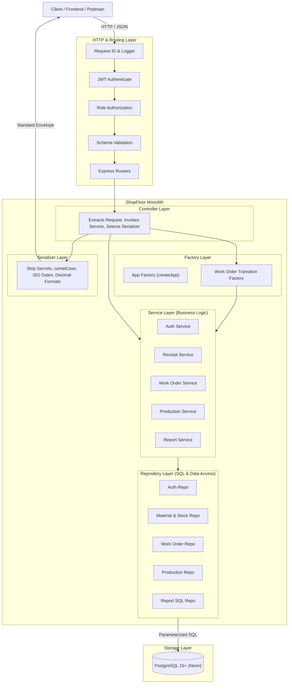

# ShopFloor System Architecture

The complete system architecture documentation is available in [**`docs/architecture.md`**](file:///e:/SHOPFLOOR_BACKEND/docs/architecture.md).

For quick reference, see below:

---

## 1. High-Level Architecture

---

## 2. Core Architectural Pillars

- **Strict Layer Separation**: Controller $\to$ Service $\to$ Repository $\to$ Database.
- **Factory Design Patterns**:
  - **App Factory (`createApp(deps)`)**: Decouples Express application assembly from port binding for isolated, ephemeral automated test runs.
  - **Domain Transition Factory (`WorkOrderTransitionFactory`)**: Encapsulates work order lifecycle transitions (`DRAFT`, `RELEASED`, `IN_PROGRESS`, `COMPLETED`, `CANCELLED`) polymorphically behind a unified interface.
- **Transactional Stock Integrity**:
  - Available inventory formula: $\text{available} = \text{on\_hand} - \text{reserved}$.
  - Atomic reservations using pessimistic row-level locks (`SELECT ... FOR UPDATE` ordered by `material_id ASC`).
  - Database check constraints `CHECK (on_hand >= 0 AND reserved >= 0)` and `CHECK (reserved <= on_hand)`.
  - Immutable, append-only `stock_movements` ledger (`RECEIPT`, `RESERVE`, `UNRESERVE`, `CONSUME`).
- **Complete Details**: Please read the full document at [**`docs/architecture.md`**](file:///e:/SHOPFLOOR_BACKEND/docs/architecture.md).
