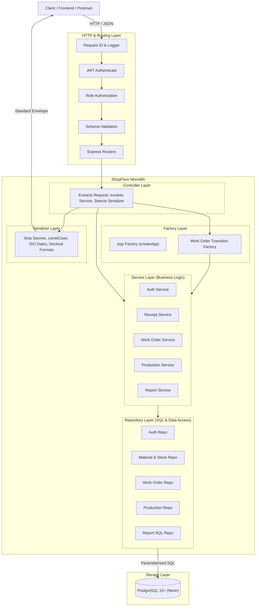
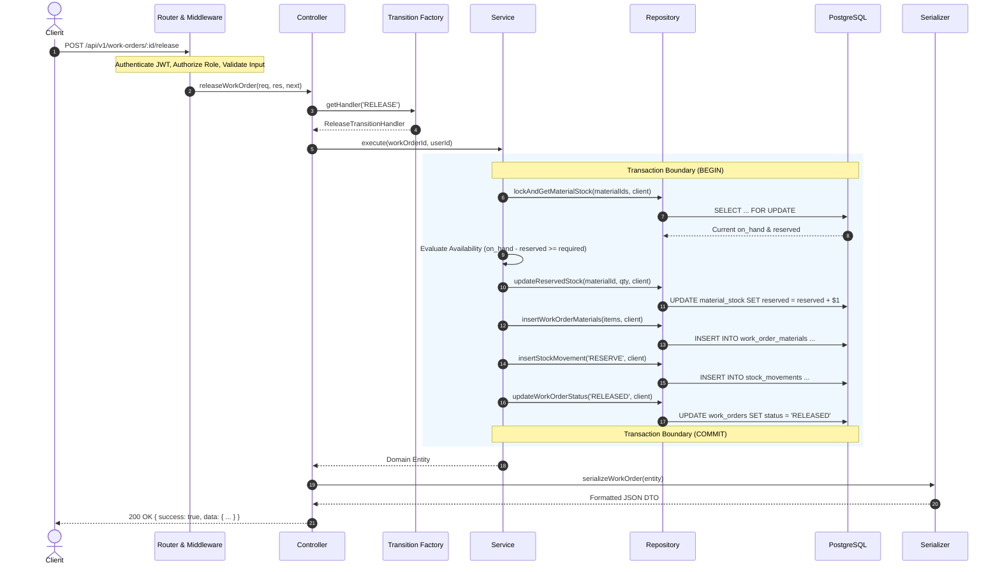
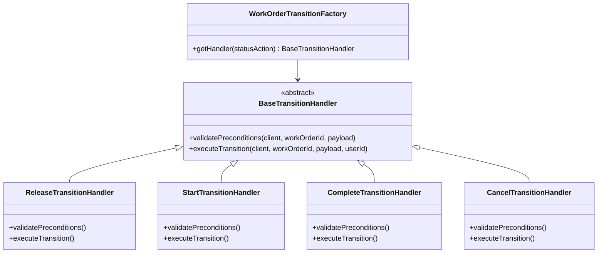
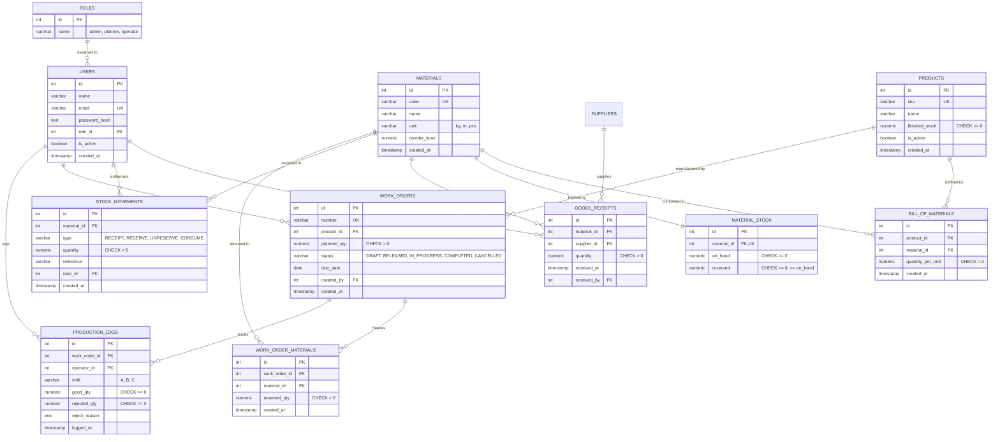
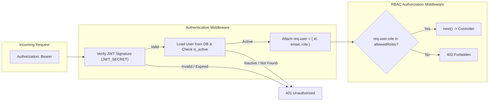
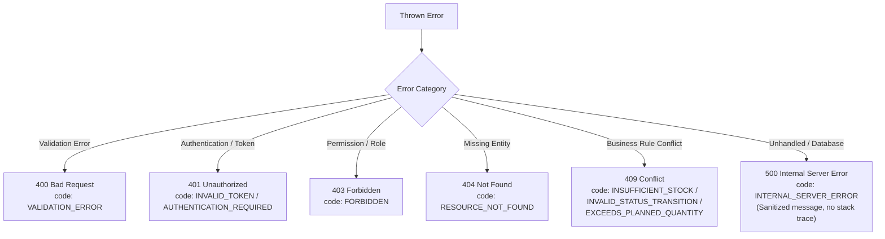

# ShopFloor System Architecture

## 1. Overview & Architectural Principles

ShopFloor is built as a modular monolith adhering to Clean Architecture principles, Domain-Driven Design (DDD) encapsulation, and strict vertical-slice layering. The system manages the manufacturing lifecycle for discrete furniture production, coordinating raw material procurement, BOM-driven inventory reservations, work order state machines, and shift production tracking.



### Core Design Principles
1. **Strict Layer Order**: Controllers never execute SQL; Repositories never make business decisions; Services never touch `req` or `res`.
2. **Transactional Inventory Consistency**: Every operation that alters raw materials, finished stock, or reservations occurs in a single ACID transaction accompanied by an immutable ledger entry in `stock_movements`.
3. **Database-Enforced Invariants**: Critical business rules (e.g., non-negative inventory, `reserved <= on_hand`) are enforced via database `CHECK` constraints, guaranteeing data integrity even under extreme concurrency.
4. **Decoupled Application Lifecycle**: Network listening is separated from application assembly via an App Factory (`createApp(deps)`), enabling isolated, concurrent automated testing.

---

## 2. Layer Responsibilities & Data Flow



### 2.1 The Controller Layer
- **Responsibility**: HTTP protocol handling.
- **Responsibilities Matrix**:
  - Extracts parameters from `req.params`, `req.query`, and `req.body`.
  - Injects authenticated user context (`req.user.id`, `req.user.role`).
  - Delegates execution to the domain service or factory.
  - Passes service output through dedicated serializer functions.
  - Sends the standard HTTP response status code and JSON envelope.
- **Forbidden**: Writing SQL queries, managing transactions, or executing business logic.

### 2.2 The Service Layer
- **Responsibility**: Pure domain logic, orchestration, and transaction demarcation.
- **Responsibilities Matrix**:
  - Validates complex cross-entity business rules.
  - Coordinates database transactions (`BEGIN`, `COMMIT`, `ROLLBACK`).
  - Calls repository functions using the transactional database client.
  - Guarantees append-only ledger creation for all stock movements.
- **Forbidden**: Accessing HTTP `req` or `res` objects.

### 2.3 The Repository Layer
- **Responsibility**: Data access and SQL construction.
- **Responsibilities Matrix**:
  - Constructs parameterised queries (preventing SQL injection).
  - Executes raw SQL joins, group-by aggregations, and window functions.
  - Accepts an optional PostgreSQL client parameter to run queries within an existing transaction.
- **Forbidden**: Making business decisions (e.g., deciding whether stock is sufficient).

### 2.4 The Serializer Layer
- **Responsibility**: Transforming internal database tuples into external API contracts.
- **Rules**:
  - Strips all internal columns (`password_hash`, internal IDs where not relevant).
  - Converts snake_case database columns into camelCase JSON properties.
  - Standardizes dates to UTC ISO 8601 strings.
  - Serializes decimals consistently as native numbers.
  - Provides lightweight serializers for paged collections and nested serializers for detail views.

---

## 3. Factory Design Patterns

### 3.1 App Factory Pattern (`createApp(deps)`)
The entry point `src/app.js` exports a factory function:
```javascript
export const createApp = (deps = {}) => {
    const app = express();
    const dbPool = deps.pool || defaultPool;
    // Register middleware, routes, and global error handlers
    return app;
};
```
- **Why**:
  - **Decoupled Testing**: Tests invoke `createApp({ pool: testPool })` and bind to ephemeral ports via `http.createServer(app).listen(0)` without colliding on port 5000.
  - **Environment Agnostic**: Server startup in `src/server.js` handles process signal listening (`SIGTERM`), while `app.js` focuses purely on Express pipeline construction.

### 3.2 Domain Factory Pattern (`WorkOrderTransitionFactory`)
Rather than accumulating conditional logic across controllers, work order transitions are handled polymorphically:



- **Concrete Products**:
  1. `ReleaseTransitionHandler`: Checks stock against BOM, acquires pessimistic row locks, reserves material, and writes `RESERVE` movements.
  2. `StartTransitionHandler`: Verifies `RELEASED` status and moves state to `IN_PROGRESS`.
  3. `CompleteTransitionHandler`: Verifies logged good units, deducts consumed materials from `on_hand`, unreserves remaining stock, logs `CONSUME` / `UNRESERVE` ledger entries, and increases `finished_stock`.
  4. `CancelTransitionHandler`: Verifies that no production logs exist, restores reserved materials, and writes `UNRESERVE` movements.

---

## 4. State Machine Architecture

Work order lifecycles are modeled as a deterministic finite state machine (FSM):

```mermaid
stateDiagram-v2
    [*] --> DRAFT: POST /work-orders

    DRAFT --> RELEASED: POST /work-orders/:id/release\n[Stock Available: on_hand - reserved >= required]
    DRAFT --> CANCELLED: POST /work-orders/:id/cancel\n[No reservations to release]

    RELEASED --> IN_PROGRESS: POST /work-orders/:id/start\n[Shop floor production commences]
    RELEASED --> CANCELLED: POST /work-orders/:id/cancel\n[Releases all reserved stock]

    IN_PROGRESS --> IN_PROGRESS: POST /work-orders/:id/production-logs\n[good + rejected <= planned_qty]
    IN_PROGRESS --> COMPLETED: POST /work-orders/:id/complete\n[good_qty > 0; Consumes stock & adds finished goods]
    IN_PROGRESS --> CANCELLED: POST /work-orders/:id/cancel\n[Permitted ONLY if COUNT(production_logs) == 0]

    COMPLETED --> [*]
    CANCELLED --> [*]

    note right of RELEASED
        Materials frozen in
        work_order_materials
    end note

    note right of COMPLETED
        Stock movements:
        CONSUME actual units,
        UNRESERVE leftover
    end note
```



---

## 5. Entity-Relationship Data Model

The database schema utilizes relational constraints to guarantee data integrity across users, inventory, BOMs, and manufacturing logs:



---

## 6. Security & Role-Based Access Control (RBAC)

The security subsystem enforces authentication and fine-grained authorization:



### RBAC Matrix
| Endpoint / Resource | Admin | Planner | Operator | Public |
| :--- | :---: | :---: | :---: | :---: |
| `GET /health` | ✓ | ✓ | ✓ | ✓ |
| `POST /auth/login` | ✓ | ✓ | ✓ | ✓ |
| `POST /materials/:id/receipts` | ✓ | ✓ | — | — |
| `PUT /products/:id/bom` | ✓ | ✓ | — | — |
| `POST /work-orders` (create DRAFT) | ✓ | ✓ | — | — |
| `GET /work-orders` (paged list) | ✓ | ✓ | ✓ | — |
| `GET /work-orders/:id` (detail) | ✓ | ✓ | ✓ | — |
| `POST /work-orders/:id/release` | ✓ | ✓ | — | — |
| `POST /work-orders/:id/start` | ✓ | ✓ | ✓ | — |
| `POST /work-orders/:id/production-logs` | ✓ | — | ✓ | — |
| `POST /work-orders/:id/complete` | ✓ | ✓ | — | — |
| `POST /work-orders/:id/cancel` | ✓ | ✓ | — | — |
| `GET /reports/*` | ✓ | ✓ | — | — |

---

## 7. Error Handling Architecture

The application adopts a centralized error envelope. Controllers catch operational errors or delegate unhandled errors to Express's global error handler:

### Standard Error Envelope
```json
{
  "success": false,
  "error": {
    "code": "INSUFFICIENT_STOCK",
    "message": "Not enough stock to release WO-2026-0007",
    "details": [
      { "materialCode": "M001", "required": 120, "available": 80 }
    ]
  }
}
```

### Error Classification


---

## 8. Scalability & High-Concurrency Strategy

1. **Deadlock-Free Row-Level Locking**:
   - Stock allocations acquire row locks via `SELECT ... FOR UPDATE` with deterministic ordering (`ORDER BY material_id ASC`), eliminating circular lock dependency deadlocks.
2. **Pre-Aggregated Inventory Balances**:
   - `on_hand` and `reserved` are maintained in `material_stock`, avoiding runtime sum scans across millions of ledger entries in `stock_movements`.
3. **Connection Pooling**:
   - Uses `pg.Pool` with parameterized query planning, prepared statement re-use, and client checkouts wrapped in `try ... finally { client.release(); }`.
4. **Time-Series Partitioning Strategy (Production Scale)**:
   - For high-volume plants, `stock_movements` and `production_logs` can be partitioned by month (`RANGE (created_at)`), ensuring that active ledger lookups stay in memory.
